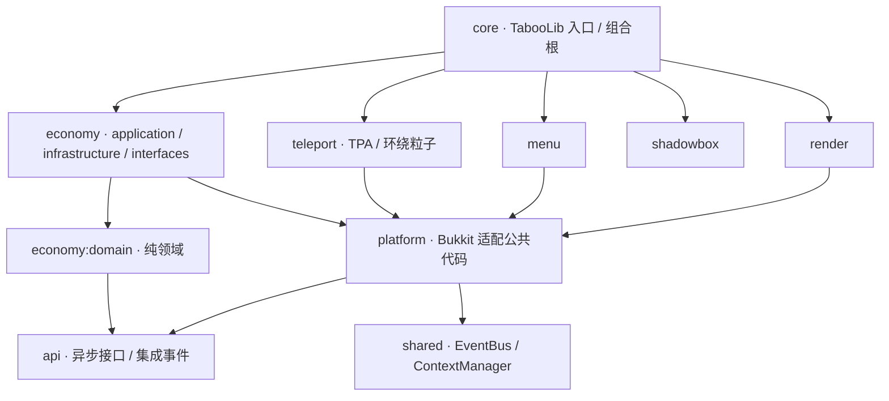

# Meowo

面向 **Paper / Minecraft 26.2** 的 Kotlin 多模块插件脚手架。包含可持久化的经济系统、玩家转账、付费 TPA 与登录补助、交互钱包菜单、客户端假实体渲染，以及可独立启停的业务 context。

原始需求见 [plan.md](plan.md)，实际版本核对见 [docs/versions.md](docs/versions.md)。plan 作为设计参考，不能作为可直接编译的 API 示例。

改动本项目前先读 [docs/minimax/](docs/minimax/README.md)：那里记录了架构红线、生命周期与线程模型、数据不变量、逐步改造配方，以及本机环境的坑（含 iCloud 导致的构建失败）。

## 快速开始

准备 JDK **21 + 25**：Gradle 8 的 daemon 使用 21，编译、JUnit 和 Paper 使用 25。Gradle 会自动发现已安装的 JDK；也可在用户级 `gradle.properties` 设置 `org.gradle.java.installations.paths`。不需要系统安装 Gradle。启动脚本另需 Bash、curl 和 Python 3。

```bash
./gradlew test :core:build verifyArchitecture verifyCoverage
# 单 jar 产物：core/build/libs/Meowo-1.0.0.jar
```

复制 jar 至 Paper 的 `plugins/`。渲染功能另需 [PacketEvents 2.14.0](https://github.com/retrooper/packetevents/releases/tag/v2.14.0)，不安装时 economy/menu 仍可启动，render 会报告依赖缺失。TabooLib 会在首次启动下载自身运行时模块，需要访问 Maven Central 和 TabooLib 仓库；离线部署需预先准备**服务端根目录下的 `libraries/`** 缓存。

**SQLite 驱动同样走运行时下载，不随 jar 分发。** 它的原生库覆盖 6 个平台共 24 个架构（约 24 MB），而单台服务器只用得上其中一个约 2 MB 的文件——把它打进 jar 会让 90% 的体积变成永不加载的死重量。因此 jar 只声明依赖（`MeowoCore` 上的 `@RuntimeDependencies`），首次启动时下载进**服务端根目录的 `libraries/`**（与 TabooLib 自身的运行时模块同一个目录）。离线部署与 TabooLib 模块同理：预置该目录即可。Kotlin 标准库与 Meowo 各模块仍随主 jar 分发。

> 若 `libraries/` 中残留了其它版本的 sqlite-jdbc，TabooLib 会优先复用已缓存的那一份而不是重新下载。升级驱动版本时请一并清掉 `<服务端根目录>/libraries/org/xerial/`。

首次启动本地测试服前，阅读 [Minecraft EULA](https://aka.ms/MinecraftEULA)。同意后：

```bash
ACCEPT_MINECRAFT_EULA=true ./scripts/start-server.sh
# 或
ACCEPT_MINECRAFT_EULA=true ./gradlew :core:runServer
```

开发脚本固定 Paper build 129、PacketEvents 2.14.0，并校验 SHA-256。测试服位于 `.run/server`，仅监听 `127.0.0.1:25565`，采用离线模式；该配置仅用于本机开发。用 `MEOWO_JAVA=/absolute/path/to/java` 指定 Java 25，用 `MEOWO_RUN_DIR` 指定其他服务端目录。停止时在服务器控制台输入 `stop`。

客户端不会下载或绕过正版认证。先在 Prism Launcher 创建 **26.2 / Java 25** 实例并登录已有 Minecraft 账号：

```bash
MEOWO_CLIENT_INSTANCE='你的实例 ID' ./scripts/start-client.sh
# launcher 不在 PATH 时再指定 MEOWO_CLIENT_LAUNCHER=/absolute/path/to/prismlauncher
MEOWO_CLIENT_INSTANCE='你的实例 ID' ACCEPT_MINECRAFT_EULA=true ./scripts/dev.sh
```

`dev.sh` 在本地端口就绪后调用 Prism 直连。未配置客户端实例会给出明确错误，不会伪造启动成功。

## 架构与目录



```text
api/                         无平台依赖的公共契约
shared/                      无平台依赖的事件总线和生命周期管理
platform/                    命令路由、语言包、主线程切换
core/                        唯一入口、配置、模块装配、集成测试
contexts/meowo-economy/
  domain/                    独立 Gradle 模块：Money / Wallet / Repository / DomainService
  src/main/kotlin/.../
    application/             异步用例编排，提交后发布事件
    infrastructure/          SQLite 钱包与流水
    interfaces/              命令解析和权限
contexts/meowo-menu/          轻量菜单与跨 context API/事件示例
contexts/meowo-render/        领域模型 / RenderService / PacketEvents 适配器
contexts/meowo-shadowbox/     潜影盒：Shift 右键 / 潜行右键直接开箱
contexts/meowo-pomodoro/     番茄钟：状态机 / 预设 / BossBar·Title·TextDisplay / SQLite
contexts/meowo-shop/         喵达 ModaCat 商店：矿石价目表 / /sell 回收 / 钱包结算
contexts/meowo-webapi/       只读 HTTP 接口：给 Wofuf 的 Cloudflare Worker 拉取服务器数据
contexts/meowo-avatar/       不睡不刷幻翼 + 调整体型：每个玩家自己的一份（见 docs/minimax/17）
contexts/meowo-chat/          后续扩展示例文档
scripts/                     服务端、客户端、联调启动
```

依赖方向为 `interfaces → application → domain`，基础设施实现领域端口，由 context 装配。完整的 economy 领域被拆为**真正独立的 Gradle 模块**，而非仅按文件夹声称隔离。menu/render 按功能复杂度简化，避免空壳 Repository 或机械的一方法 UseCase。

`verifyArchitecture` 检查纯模块平台引用与 context 之间直接导入。跨 context 只允许 `api` 中契约与事件，具体实现只由 core 装配。

## 只读 HTTP 接口（meowo-webapi）

`contexts.webapi` 默认**关闭**（它会开一个端口）。打开后插件在本机 `127.0.0.1:8080` 提供：

| 端点 | 说明 |
|---|---|
| `GET /health` | 存活检查，不需要密钥 |
| `GET /api/v1/snapshot` | 一次拿到全部：服务器状态 + 每个玩家的统计/成就/皮肤 URL |
| `GET /api/v1/players` | 在线玩家列表 |
| `GET /api/v1/server/status` | 服务器状态 |
| `GET /api/v1/statistics/{uuid}` | 某玩家的统计 |
| `GET /api/v1/advancements/{uuid}` | 某玩家的成就 |
| `GET /api/v1/skins/{uuid}` | 某玩家的皮肤（URL，不是图片） |

除 `/health` 外都要带请求头 `X-Meow-Secret`，值等于 `config.yml` 的 `webapi.secret`；
`webapi.secret` 留空时该 context **拒绝启动**——一个没人能鉴权的端口比没有端口更糟。
另有 `webapi.allowed-ips` 白名单；方法只有 GET / HEAD。

它服务的是**快照**而不是实时读：Bukkit API 不是线程安全的，主线程每
`webapi.snapshot-interval-seconds` 秒构建一次不可变快照，HTTP 线程只读已发布的值。
皮肤只给 URL，下载在消费方（Worker）那边做，不占主线程。

外部访问请在同机跑 Cloudflare Tunnel（Worker 在公网边缘，访问不到 `127.0.0.1`），
**不要**把这个端口直接暴露到公网。

## 命令与权限

| 命令 | 权限 | 行为 |
|---|---|---|
| `/meowo help`、`info` | `meowo.use`，默认所有人 | 帮助、版本、启用模块、订阅数 |
| `/meowo reload` | `meowo.admin`，默认 OP | 校验并重载语言和模块开关 |
| `/meowo eco balance [玩家/UUID]` | `meowo.economy.balance` | 默认查询自己；他人需 `.balance.others` |
| `/meowo eco give <玩家/UUID> <金额>` | `meowo.economy.give` | 增加余额 |
| `/meowo eco take <玩家/UUID> <金额>` | `meowo.economy.take` | 扣款，禁止透支 |
| `/meowo eco set <玩家/UUID> <金额>` | `meowo.economy.set` | 设置余额 |
| `/meowo menu` | `meowo.menu`，默认所有人 | 打开总菜单；布局（心形）见 `ui.yml` 的 `screens.menu` |
| `/meowo render spawn <数量>` | `meowo.render`，默认 OP | 仅向自己发送盔甲架生成包 |
| `/meowo render clear` | `meowo.render` | 清除自己的假实体 |
| `/meowo spawn` | `meowo.spawn`，默认所有人 | 免费传送回世界出生点 |
| `/meowo setspawn` | `meowo.spawn.set`，默认 OP | 把世界出生点设为你的位置 |
| `/meowo home [编号或名称] [force]`、`/sethome`、`/delhome` | `meowo.home`，默认所有人 | 家与回家传送；`force` 见下（需 `meowo.home.force`） |
| `/meowo sit` | `meowo.sit`，默认所有人 | 切换坐下/起身；脚下无地面时拒绝 |
| `/meowo ride [玩家]` | `meowo.ride`，默认所有人 | 骑上附近 3×3 范围的玩家，已有乘客则堆叠至最上层；不带参数则下坐骑 |
| `/meowo hat` | `meowo.hat`，默认所有人 | 把手上的**头盔**与头上交换；空手执行则摘下头盔 |
| `/meowo phantom` | `meowo.phantom`，默认所有人 | 开关原版「不睡觉就刷幻翼」的机制：开启后整夜不睡也没有幻翼来找你（只影响你自己） |
| `/meowo size [up\|down\|reset\|倍数]` | `meowo.size`，默认所有人 | 调整自己的体型（0.5～3 倍，步长 0.25）；用原版的 `scale` 属性 |
| `/meowo afk` | `meowo.nametag.afk`，默认 OP | 手动标记离开（普通玩家只能靠无操作超时自动进入） |
| `/shadowbox` | `meowo.shadowbox`，默认所有人 | 打开主手上的潜影盒 |
| `/shadowbox give <玩家>` | `meowo.shadowbox.give`，默认 OP | 发放一个潜影盒 |
| `/meowo pomodoro`、`/pomodoro`、`/pomo` | `meowo.pomodoro`，默认所有人 | 番茄钟：`gui`（默认）/ `start <预设>` / `pause` / `resume` / `stop` / `next` / `stats` / `visuals <bossbar\|title> <on\|off>` |
| `/sell` | `meowo.shop`，默认所有人 | 喵达 ModaCat 商店：`/sell` 卖光背包（先确认）/ `sell all <矿物>` / `sell hand` / `sell gui` 价目表 |

回家的落点检查是严格的：保存坐标那两格必须能站人、脚下是实体方块、不在岩浆或火里、还在世界边界内。
这在**设家那一刻**是对的，但坐标不会跟着世界变——把家底下的方块挖掉、把自己砌进墙里、动了世界边界，
之后每次 `/meowo home` 都会判成「落点不安全」而回不去，只能重新付费迁址。
为此提供**强制传送**：`/meowo home <编号或名称> force`（GUI 里也有对应按钮），忽略落点检查、
直接回到保存时的原坐标，费用与普通回家相同。区块仍会异步加载、坐标超出世界高度仍会拒绝、
倒计时与移动取消规则不变。开关是 `home.force`，权限是 `meowo.home.force`（默认所有人）。

静止 **180 秒（3 分钟）** 自动进入挂机。挂机期间玩家进入**假离线**状态：免疫一切伤害、被取消击退、
`isCollidable=false` 因此推不动，并持续清除附近怪物的锁定目标。
离开时精确恢复玩家原本的「是否无敌/是否可碰撞」，不会把创造模式的无敌清掉。
屏幕中央显示挂机标题与退出方法（**下蹲、挥手、吃东西、切换物品栏或发言**）。
插件**从不移动挂机中的玩家**：走动不解除挂机，但被生物或船拖走超过 5 格会直接解除挂机。

### 根级快捷方式

除 `help` 和 `reload` 外，每个子命令都可以**直接在 `/` 下使用**，不需要 `meowo` 前缀：

```
/info  /eco  /menu  /render  /spawn  /setspawn  /sit  /ride  /hat  /shadowbox
/pay  /tpa  /tpaccept  /tpdeny  /tpacancel  /back
/mail  /msg  /home  /homes  /sethome  /delhome  /invsee  /afk
/mine  /pomodoro  /pomo  /sell  /phantom  /size
```

另有 `/meo [子命令]` 作为 `/meowo` 的短别名。

> 这份清单与 `MeowoRuntime.aliases` 一一对应，`plugin.yml` 里声明的每条指令都在其中。
> 两张表由 `MeowoRuntimeTest` 自动比对：少写一条不会有人发现，多写一条则 Bukkit 会解析到
> 一个没有执行器的指令，只回一句 `usage:`。

> **为什么 `help` 和 `reload` 没有下沉**：Bukkit 里同名插件命令会**覆盖**原版 `/help`，
> 玩家会因此看不到服务器完整命令列表；`/reload` 则是服务器管理插件的常规领地。
> 两者保留在 `/meowo` 与 `/meo` 后面。

`sit` 与 `ride` 遵循主流做法：坐下时在脚下生成一个不可见盔甲架，起身即移除；
骑乘借用他人载具但**绝不删除**它。两者都支持潜行脱离。骑乘不消耗经济资源。

**潜影盒**是自带物品栏的盒子，**物品栏里 Shift + 右键**或**手拿它 Shift + 右键**都能直接打开，
不用先把方块放进世界。两个键位对**所有玩家开放**，不需要任何权限。
**任何自带窗口大小背包的方块物品都算潜影盒**——任何颜色的潜影贝盒、箱子、木桶、末影箱，
玩家自己捡到的也能开，不要求是 `/shadowbox give` 发的。
盒子里的东西存在物品自己身上（和原版潜影贝盒同一个机制），所以掉落、交易、存箱子、
死亡掉落都会跟着盒子走，也没有需要维护的数据库。用 `/shadowbox` 打开主手上的盒子
等价于两个键位，给基岩端和不方便潜行的玩家留了同一条路。

`hat` 默认**除工具外任何物品都能戴**（羊毛、灯笼、唱片，甚至胸甲），
换下来的旧头饰进背包而不是丢弃。物品栏里也能直接点到头部槽——
客户端本身禁止放非护甲，所以这一步由插件拦截 `InventoryClickEvent` 自行完成。
可用 `hat.allow-tools` / `hat.deny` 调整。

**番茄钟**的界面是**水晶柱殿**：七根柱子，柱顶晶体各代表一个功能（开始 / 暂停 / 进入休息 / 结束 /
预设长廊 / 新建预设 / 专注统计），底层两枚小水晶开关两处读数。倒计时同时出现在 BossBar、屏幕标题
和头顶漂浮文字三处（后两者玩家可各自关闭）。预设在 `pomodoro-default-presets.yml` 里随 jar 分发；
玩家可以在编辑器里**新建 / 复制 / 改数值 / 删除自定义预设**（时长左键 +1、右键 −1，名称在聊天栏输入，
保存才落库，删除先过确认页），自定义预设与每轮实际专注时长落在 `plugins/Meowo/pomodoro/pomodoro.db`。
`/meowo menu` 里也有一格直接进入（`ui.yml` 的 `screens.menu`，槽位 21）。

两处**与上游 Java 插件不同**的取舍，都是本项目的红线决定的：

- **不冻结、不拉回。** 上游可以在工作期间冻住玩家，并在越界时把玩家拽回原位。Meowo 不剥夺玩家
  的移动控制，所以 `pomodoro.max-distance` 只做「越界即自动暂停 + 警告」——回不回来由玩家决定。
- **头顶文字是"不持久化"实体。** `TextDisplay` 是真实世界实体，会被写进区块存档；崩溃或非正常关停
  一次就会在世界里永久留下一个冻住的计时器，而且只有制造它的玩家看不见。因此它 `isPersistent=false`，
  只活在内存里（最坏情况丢的是一个读数）。PacketEvents 不在时这一项自动降级，BossBar 与标题照常工作。

别名 `/mw`。管理权限树显式声明 `meowo.economy.*` 的子权限。控制台经济操作必须指定目标。玩家名仅查在线/缓存资料，避免主线程发起网络 UUID 查询；从未见过的离线玩家请直接用 UUID。

## 配置与生命周期

`plugins/Meowo/config.yml`：

```yaml
language-mode: player # player=按玩家客户端语言自动切换；server=全服统一用 locale
locale: zh_CN # 控制台与未提供语言的文件使用的兜底语言
contexts:
  economy: true
  menu: true
  render: true
  teleport: true
  spawn: true
render:
  max-per-player: 200 # 1..1000，限制每个玩家当前总数
```

> **菜单不在 `config.yml` 里。** 菜单的每一格写在 `ui.yml` 的 `screens.<界面>.buttons` 下，
> `config.yml` 里已经没有 `menu.items` 这一段——留着它只会让人以为改了就能生效。

> **密钥可以走环境变量。** `agents.api-key` 与 `webapi.secret` 除了写在文件里，也可以用
> `MEOWO_AGENTS_API_KEY` / `MEOWO_WEBAPI_SECRET` 提供。**环境变量优先**，且启动日志会说明用的是
> 哪一个——不然「改了文件却没生效」会变成一桩无头案。密钥该待在机器上，不该躺在一个可能被备份、
> `world/` 目录或 git 仓库捡走的文件里。

> **配置文件和读它的代码不许各走各的。** `core/src/test/kotlin/com/meowo/core/ConfigSchemaTest.kt`
> 是一道门禁（跟着 `test` 跑，不需要单独记住）：它检查 `config.yml` 的 `contexts:` 块、
> `settings.gradle.kts` 的模块、运行时装配启用的 context、以及代码实际读取的配置键，四者必须对得上。
> 一份「有注释、随包分发、却没有任何代码读」的配置项，和一个写错的配置项，在服主眼里长得一模一样——
> 前者要等服主调了很久才会被发现。这道门禁的清单全部是**推导**出来的，不是写下来的。

> **`config-version` 是全局的版本号。** 它管着两份服主可以改的文件：`config.yml`（选项）和
> `ui.yml`（菜单布局）。启动与 `/meowo reload` 时，凡是版本落后的文件都会被补上 jar 里新增的键，
> 并带上原注释——**只补没有的，已有的一律不动**。以前版本号只管 `config.yml`，插件加了菜单按钮、
> 版本号不动，服主的 `ui.yml` 就永远不会被补；而布局是「服主那份整个说了算」，新按钮于是不见了，
> 日志里一个字也没有。改配置的**任何一部分**（选项或布局）都要 +1。
>
> 语言包**不**参与这次合并：它装的是文案而不是设置，jar 里的那份本来就会补齐服主文件缺的每一个键；
> 把文案合并进服主文件只会把它**冻住**，以后版本里改好的措辞就再也到不了这台服。
> 服主没做过的 `ui.yml` 插件也**不会**替他创建——随包那份必须继续当默认，否则以后的布局改动就冻住了。

### 可配置的菜单

`/meowo menu` 的每一格都写在 `ui.yml` 的 `screens.<界面>.buttons` 下，没有写死的地方：

| 键 | 说明 |
| --- | --- |
| 槽位号 | 格子编号 0..53，直接写在 `buttons:` 下面 |
| `icon` | 材质名 |
| `name` / `lore` | 文本；写语言包里的键就随玩家语言切换，写文字就原样显示（`&` 颜色码） |
| `permission` | 填了就只对有权限的玩家显示（不是点了才拒绝） |
| `action` | 一条指令（以点击者本人执行），或内置动作 `@main-menu` / `@back` / `@close` / `@none` |
| `action-right` / `action-shift` | 右键、Shift+左键各做一件事 |

两条设计上的取舍：

**命令以玩家身份执行，而不是控制台。** 这让菜单能绑上任何已有指令——本插件的、别的插件的、第三方插件的——而不需要这里知道那条指令存在；同时那条指令自己的权限检查照常生效，所以一格菜单永远不会变成绕过权限的后门。想让一格只对会员可见，就再写一个 `permission`。

**整块 `buttons` 写了就完全以你为准**，内置的格子不会自动补回来（忘了写关闭也没关系，ESC 一样能关）。

**总菜单画成一颗心**（`screens.menu`，`pillars: false` 表示这一屏不画柱身）。轮廓是紫水晶块，
心里是功能按钮：家园 / 番茄钟 / 商店 / 钱包，加上**幻翼**（免除原版失眠幻翼）与**体型**两个开关分列核心两侧。镜像格是
`9 × 行 + (8 − 列)`，改一格就要连它的镜像格一起改。规范见 [docs/ui-style.md](docs/ui-style.md)。

所有库存菜单共用一套外观：`platform` 的 `MenuChrome` 画**水晶柱**边框（顶端发光晶体＝可点的功能，
左右两列是装饰立柱），`menu` / `home` / `pomodoro` 三处复用同一份几何与配色。内容格固定 `10..43`、
导航固定 `45/49/50/53`，chrome 只画边框、绝不覆盖内容格——所以一格「不放」就等于隐藏它。
完整规范见 [docs/ui-style.md](docs/ui-style.md)。

配置写错（槽位越界、两格撞槽位、未知 `action`、命令项没有 `command`）时**拒绝整次重载**并在日志里点名是哪一格，运行中的菜单保持原样——这是全局约定：配置解析失败保留运行中的模块。

`lang/zh_CN.yml`、`lang/en_US.yml` 可编辑。缺失键回落到内置同语言文本，非法键类型拒绝重载。已接受的异步命令在回复时使用当前语言。关闭菜单模块或切语言会关闭已有菜单，避免旧标题残留。

语言文件支持 `§` 传统颜色码和 `\n` 换行。颜色只对玩家渲染，控制台与 RCON 会自动去除色码，因此两条语言都要在去色后仍可读；换行会拆成多条聊天消息。占位符为 `{0}` `{1}`，按顺序替换。颜色是修饰而非语义——管理员可以改成纯文本，功能不受影响。约定与配色语义见 [docs/minimax/05 §4](docs/minimax/05-改造手册.md)。

玩家看到的聊天消息都带发言者，渲染为 `<名字> 内容`，命名规则 `XxxCat`（`Xxx` 恰好 4 字符，聊天栏等宽）：`MeowCat`（系统与通用）、`EconCat`、`MenuCat`、`RendCat`、`WarpCat`、`TeleCat`。名字可在 `lang/*.yml` 的 `speaker-*` 键里改。这些是**系统消息**而非真实玩家发言，因此没有签名与玩家档案——不能私聊、@ 提及或删除消息，客户端可能显示「无法验证」指示条。机制与取舍见 [docs/minimax/09](docs/minimax/09-模拟玩家发言可行性.md)。控制台不显示发言者。

十二只猫各有自己的**聊天范围**：`/msg EconCat` 问余额它就答，问到不属于它的事，它会说不归它管并把人指给对的那只猫，而不是自己编。范围是硬边界——猫只能读服务器上的数据，没有任何处罚、封禁或改余额的能力。猫只知道这台服务器和 Minecraft 里的事：问到现实世界的新闻、天气一类的事，它会说自己不知道。猫只认**名字**：`EconCat`、`NestCat`、`TeleCat`……不会自称「精算师」「房东」，也不会让你去问「房东」——你要打的是名字。每只猫还有自己的性格（`EconCat` 是冷得只谈数字的 INTJ，`MineCat` 是惜字如金的 ISTP），说话的长短由性格决定，上限 320 字。范围、性格与世界边界的定义见 [docs/minimax/15 §8b](docs/minimax/15-chat.md)。

> 升级了插件的老服务端：`config.yml` 里的 `agents.max-tokens` **要手动改成 1024**。推理模型的思考和正文共用这一份额度，512 只够思考——不改的话，话多的猫会被从中间截断。`config.yml` 的自动合并只补缺失的键，不会动你已经写着的值。

子模块并非独立 Bukkit 插件，不支持第三方 PlugMan 对其单独卸载。使用配置开关和 `/meowo reload`。每个 context 显式持有订阅、命令、服务、监听器和数据资源；按逆序停用。关闭 economy 先移除入口，等待已接受的任务结束，再关闭数据库。若等待超过 30 秒则明确记录失败，工作线程继续排空，数据库由线程终止回调最终关闭；不会在任务执行中强行关连接。关闭菜单不影响经济服务；关闭经济后菜单显示不可用。

配置解析失败保留运行中的模块。某个模块启动失败会清理该模块并记录堆栈，其他模块继续运行；`info` 展示实际启用状态，重载命令会报告部分失败。

## 钱包与并发语义

- `Money` 是固定精度值对象：整数分，范围 `0..999999999999.99`，拒绝负数、多余有效小数及溢出，不进行隐式四舍五入。
- SQLite 文件：`plugins/Meowo/economy/wallets.db`，WAL 模式；修改余额和写流水在同一笔 `BEGIN IMMEDIATE` 事务中完成，失败回滚。
- 每个经济 context 使用一个有界专用执行器，队列满或已关闭时明确返回 `UNAVAILABLE`。命令不会在 tick 线程执行 JDBC。
- `EconomyAPI` 返回 `CompletionStage<BigDecimal>`；成功值是操作后的余额。失败通过 exceptional completion 返回；业务错误为 `EconomyException.code`，存储错误保留原始异常。
- 事务提交后同步发布不可变 `BalanceChanged`；订阅者的普通异常单独记录，不影响其余订阅者或把已提交的支付变成失败。
- 事件不是持久化消息队列。进程在提交后、通知前崩溃，通知可能丢失；菜单可重新查询。需要可靠外部通知时再引入事务 outbox。
- 转账通过 `SettlementAPI.transfer` 原子更新两个钱包；传送预扣与结算使用持久化请求 ID 去重。当前不提供跨服共享余额或通用转账撤销。

## EventBus 设计

使用每个运行实例注入的 `EventBus`，没有全局可变单例，也不使用 `Class` 到函数的未检查类型转换。精确类型匹配，按订阅顺序同步执行，返回 `AutoCloseable` 订阅句柄。并发发布被序列化；退订等待当前回调结束并阻止未来回调。允许嵌套发布，嵌套事件立即分发。关闭后不接受新订阅；后续通知丢弃，避免关闭竞态将已提交的付款错误地报告为失败。

事件回调运行在**发布线程**。跨进程或耗时任务不要放在回调中，也不要在回调中等待另一个发布线程。Bukkit 操作通过 `PlatformHost.mainThread` 调度，并在执行时检查 context 是否仍启用。线程模型属于应用和平台边界，不另设一个行为不确定的全局 `AsyncEventBus`。

## 其他插件调用 API

调用方 `plugin.yml` 声明 `depend: [Meowo]`，编译时依赖本项目 `api` jar（`compileOnly`，不要再打包一份 API）。利用 Bukkit 的服务注册表避免不可撤销的全局 `lateinit`：

```kotlin
val economy = server.servicesManager.load(com.meowo.api.EconomyAPI::class.java)
    ?: error("Meowo economy context is disabled")
economy.deposit(player.uniqueId, BigDecimal("10.00")).whenComplete { balance, error ->
    // 此处可能在数据库线程；不要直接访问 Player / Bukkit world。
    server.scheduler.runTask(this, Runnable {
        if (error != null) logger.warning("Payment failed: ${error.message}")
        else logger.info("New balance: $balance")
    })
}
```

模块重载后应重新取得服务；旧服务引用会拒绝新请求。为便于 Java 插件消费，公开接口只使用 JDK 类型，不在签名里暴露 Kotlin Result、Money 或 Bukkit Player。

## 新增 context：chat 示例

完整步骤见 [contexts/meowo-chat/README.md](contexts/meowo-chat/README.md)。流程：

1. 创建模块目录、`build.gradle.kts`，在 settings 中 include。
2. 从纯领域规则开始；复杂领域再拆独立 domain 模块。
3. 设计 application 服务、基础设施端口和外部适配器。
4. 在 api 中定义跨 context 契约，不导入其他 context 实现。
5. 实现 `Context`，显式登记每项可关闭资源。
6. 仅在 core 组合根增加构造和启停配置，并添加 `taboo(project(...))` 打包依赖。
7. 添加领域测试、必要的 MockBukkit 接口测试、语言键和权限。
8. 执行构建、架构检查、覆盖率检查和真实服务器验收。

## 验证

```bash
./gradlew test :core:build verifyArchitecture verifyCoverage
```

领域测试不启动 MockBukkit；持久化测试使用临时 SQLite，覆盖重启、回滚、两连接并发更新；core 中 MockBukkit 测试覆盖命令、权限、菜单、语言和模块重载。报告位于 `build/reports/jacoco/coverageReport/html/index.html` 及各模块的 `build/reports/tests/test/index.html`。`verifyCoverage` 要求总体行覆盖率 ≥70%、economy domain ≥90%。

第三道门禁是**配置门禁**（`ConfigSchemaTest`），跟着 `test` 跑，不需要单独记住：它检查 `config.yml` 的 `contexts:` 块、`settings.gradle.kts` 的模块、`MeowoRuntime` 启用的 context，以及代码实际读取的配置键，四者必须对得上——见下面「配置与生命周期」一节。

实际验证结果和人工客户端待验项见 [docs/acceptance.md](docs/acceptance.md)。不能用服务端 `list` 验证实体数（它统计玩家）；客户端假实体应结合实际画面、包行为和世界实体数量确认。

## 发布

**tag 就是版本。** 推一个 `v` 开头的 tag，GitHub Actions 会构建这个版本并发布一个 Release：

```bash
git tag v1.2.3
git push origin v1.2.3
```

产物：`Meowo-1.2.3.jar` 与 `Meowo-1.2.3.jar.sha256`（SHA-256 校验文件，文件名与它校验的 jar 一致，
下载到同一个目录后 `sha256sum -c` 即可）。Release 说明由**两次 tag 之间的提交**自动生成，按
`feat` / `fix` / `build` / `docs` 等类型分组——手写的更新日志是一句「有人记得」的承诺，而提交
本身就是更新日志：它已经被写过、已经被审过，而且不可能和实际发布的东西对不上。

发布流程跑在 `.github/workflows/release.yml`，做四件事：

| 步骤 | 内容 |
|---|---|
| 读版本 | 从 tag 取版本号，格式不是 `v1.2.3` 就直接失败——版本号错一次，产物就永远对不上 |
| 构建 | `./gradlew clean` 与 `./gradlew build` 分两步跑（Gradle 不给跨模块的 `clean` 排序），**测试与三道门禁都在 `build` 里**（`check` 挂在 `build` 上），发布一个没验证过的 jar 等于没发布 |
| 校验 | jar 内部 `plugin.yml` 的版本必须和 tag 一致；算 SHA-256，并用 `sha256sum -c` 自查一遍 |
| 发布 | 建 Release，附 jar 与校验文件；jar 同时作为工作流产物留存 |

版本号**不写在 `build.gradle.kts` 里**：那里只有一个本地开发用的兜底值，发布时由 workflow 用
`-PreleaseVersion=` 传进去。一份写在构建文件里的版本号和一份写在 tag 里的版本号是两个可以互相
矛盾的事实，而矛盾的结果是「jar 叫 `Meowo-1.0.0.jar`，Release 却叫 `v1.2.0`」——服主没法核对
自己装的是哪一版。

工作流里的第三方 action 全部**钉在 40 位 commit SHA** 上（版本号写在行尾注释里）。tag 是可以被人
挪走的名字，钉 SHA 才是钉住：谁动了那个名字，谁就等于决定了这个发布流程会跑什么。

> 仓库目前还没有配置远端（`git remote -v` 为空），也没有 `gh` 命令行工具。发布前需要先
> `git remote add origin <仓库地址>`，并把仓库推上去。

CI（`.github/workflows/ci.yml`）在每次 push 与 PR 上跑同一套验证，并把 jar 作为工作流产物存下来——
一个只能看到绿勾的构建没法拿去真服上试。

## 转账、传送税与每日补助

| 操作 | 命令 |
|---|---|
| 玩家转账（付款方额外支付 1% 税） | `/pay 玩家 金额` |
| 请求传送到另一玩家 | `/tpa 玩家` |
| 接受 / 拒绝请求 | `/tpaccept [玩家]` / `/tpdeny [玩家]` |
| 取消发出的请求 | `/tpacancel` |
| 补领当日 eco 补助 | `/meowo eco daily` |
| 查看税收池（OP） | `/meowo eco treasury` |

请求者支付费用，余额按扣费前计算：`ceil(余额 × 0.001 × 100) / 100`，再限制在 1～233 Meo。成功传送才最终收税；例如 500 → 1、1000.01 → 1.01、12345.67 → 12.35、500000 → 233。发送请求会显示预估费用，实际接受时余额变化可能改变费用。余额不足不传送，未完成传送会退款。

`/spawn` 免费回城，带预热、冷却、安全落点扫描与传送后无敌；`/setspawn` 设置世界出生点。
安全落点扫描**绝不生成区块**（目标区块未加载时明确失败），且上下都有界。
详见 [contexts/meowo-spawn/README.md](contexts/meowo-spawn/README.md)。

接受流程：对方同意后**才开始扣费**，钱先进入托管；随后等待 `teleport.countdown-seconds`（默认 3 秒）才执行真正的传送。等待期内 `/tpacancel` 或实际移动会取消，费用全额退回原付款方（转头不取消）。若请求者余额不足，会提醒接受者，接受者可**再次同意为其垫付**（税额仍按申请者计算，再加上同样 1% 的支付税；只能垫付一次，且不延长请求有效期）。请求消息里的 `[接受]` / `[拒绝]` 可直接点击，命令与手动输入等价。

税收入 eco 池；默认每日首次登录领取 1 Meo，池内不足则发实际剩余金额，不凭空增发。领取日期按 Asia/Shanghai；空池时可稍后用 daily 重试，成功领取后当天不会重复发放。

在 `plugins/Meowo/config.yml` 中配置（完整样例见 `core/src/main/resources/config.yml`），之后执行 `/meowo reload`：

```yaml
economy:
  currency:
    name: Meo
    symbol: "ฅ"
  teleport-tax:
    rate: "0.001"  # 0.1%，填小数比例而非百分数
    minimum: "1.00"
    maximum: "233.00"
  pay-tax:
    rate: "0.01" # 额外向付款人收取支付额度的 1%，也用于垫付
  daily-subsidy:
    enabled: true
    amount: "1.00"
    timezone: Asia/Shanghai
teleport:
  request-seconds: 60
  countdown-seconds: 3 # 扣费后到真正传送之间的等待秒数
  particles: true
spawn:
  world: "" # 空 = 玩家当前所在世界；多服可填大厅世界名
  warmup-seconds: 3 # 站立等待，移动到别的方块或受伤即取消
  cooldown-seconds: 5 # 两次请求的最小间隔
  invulnerability-seconds: 4 # 传送后无敌，会恢复原本状态
  center-align: true
  safety: true # 出生点不安全时上下搜索安全落点（仍不会生成区块）
  safe-search-range: 16
pomodoro:
  # 工作时离开原位超过这么多格就自动暂停并警告；**不会**把玩家拉回来。
  max-distance: "16"
  # 新会话默认显示哪两个读数；玩家可用 /pomodoro visuals 各自切换。
  bossbar-default: true
  title-default: true
  text-display:
    offset-y: "2.4" # 头顶文字的高度偏移（需 PacketEvents，否则自动隐藏）
  bossbar-colors:
    work: GREEN
    break: BLUE
    long-break: YELLOW
    paused: RED
  custom-preset-limit: 16 # 每个玩家能存的自定义预设数
  sounds: # 留空字符串 = 静音该提示
    ui-click: "ui.button.click"
    timer-end-warning: "block.note_block.hat" # 最后 5 秒，每秒一声
    next-cycle: "entity.player.levelup"
    leave-warning: "entity.villager.no"
```

旧配置未填的项自动使用上述默认值，不覆盖自定义值。语言文件新键有内置回退，已有 help/eco-usage 自定义文字会保留，可自行更新。普通玩家默认具有 pay/daily/teleport 权限；税收池查询默认 OP。详细结算与恢复语义见 [economy](contexts/meowo-economy/README.md) 和 [teleport](contexts/meowo-teleport/README.md)。

支付税按支付本金向上取整到 0.01（例如 pay 2.50，税 0.03）。付款人必须有本金与税额的总余额，收款人收到完整本金；税收入 eco 登录补助池。传送等待特效为贴身快速环绕的白色符文串，成功时脚下出现按群系柔和配色、缓慢旋转的六芒星阵。反胃与黑暗覆盖等待时长及抵达后 1 秒。移动或跳跃会取消倒计时，转头不会取消；垫付时两种预扣税都退回垫付者。

## 许可

[MIT](LICENSE)。
